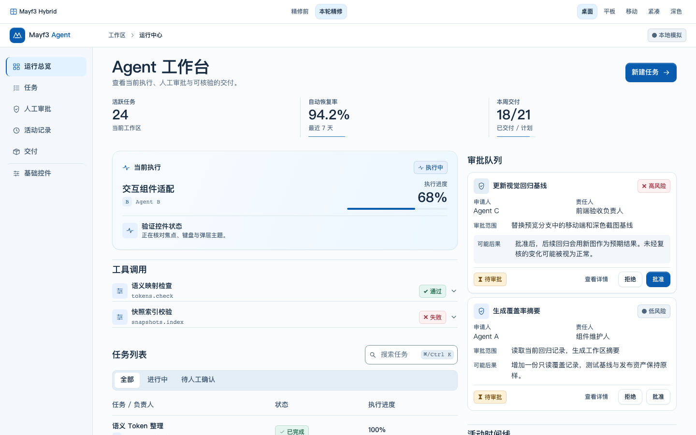

# Mayf3 Hybrid Workbench

一个可交互的 Agent 工作台原型。Hybrid Refinement 将当前执行、人工审批、任务列表和活动记录放在同一工作区，以冷白底板、局部天蓝、接触阴影和无外框指标区组织页面。



[移动端截图](docs/preview/hybrid-mobile.png) · [深色桌面截图](docs/preview/hybrid-dark.png)

## 本地预览

推荐 Node.js 24.11 或更新的 24.x 版本，使用 pnpm 10.28.1。

```sh
pnpm install --frozen-lockfile
pnpm dev
```

打开 [Hybrid Refinement](http://127.0.0.1:6006/?path=/story/premium-ui--hybrid-refinement)。工具栏可以切换精修前后、桌面 / 平板 / 移动、浅色 / 深色和密度。Storybook 可切换 LTR / RTL。

任务进度、验收通过率和交付完成率分别标注。可从 Agent C 的任务打开失败事件，查看工具调用，再尝试批准基线与重试校验。操作运行在页面内存中的模拟数据上，刷新会重置。

[Reference Study](docs/reference-study/IMPLEMENTATION.md) 可以用同一个工作台切换 Vercel、Stripe、Apple 和 Mayf3 Hybrid 四种视觉方向。

## 源码与验证

- [Hybrid UI](workbench/stories/premium-agent/) 包含工作区、Agent 组件和主题样式。
- [React 组件](packages/react/) 包含按钮、表单、对话框、标签页、开关和状态标签。
- [语义 Token](src/tokens.json) 与 [表面和光影](docs/SURFACE_LIGHTING_SYSTEM.md) 描述控件与表面的样式契约。
- [Agent 产品组件](docs/AGENT_PRODUCT_COMPONENTS.md) 说明审批、任务、工具和交付的交互契约。

```sh
pnpm verify
pnpm build:workbench
pnpm --filter @mayf3/workbench exec playwright install chromium
pnpm test:browser
```

浏览器测试包含 axe-core、键盘、RTL、Reduced Motion、主题继承和 Chromium 截图对比。提交的像素基线生成于 macOS。其他平台首次运行可添加 `--update-snapshots` 生成当地基线，再运行常规比较。

## 设计参考与许可

[设计参考](docs/DESIGN_REFERENCES.md) 记录控件、材质和 Agent 交互的灵感来源。React 子包保留既有 MIT 元数据，整仓许可尚未指定。
